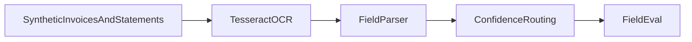

1. Extract fields from synthetic invoices/bank statements; measure accuracy per field and per template, route low confidence to review.

2. Result:
   Synthetic documents OCR evaluated: 30  
   Document-ID accuracy: 1.0  
   Total-amount accuracy: 1.0  

   Measured with `make bench`: [raw results](evidence/bench.json), [command output](evidence/checks.log), [environment](evidence/environment.json).

3. Architecture:


4. Run it:
```sh
make setup
make lint test bench
make demo
```

5. Decisions and limits: Synthetic financial records only, with original rendered templates and seeded blur/rotation. Real Tesseract OCR runs on every image. No LLM or real invoice data is used. Accuracy is exact field equality against generated ground truth. Per-field/per-template table: evidence/field-table.md; confidence tradeoff: evidence/review-curve.json and evidence/tradeoff.svg. Confidence is uncalibrated OCR confidence; no auto-approved documents yields null accuracy rather than fabricated success. Install the system tesseract executable before make setup (brew install tesseract on macOS or apt-get install tesseract-ocr on Linux).

6. Next: Evaluate more layouts, calibrate confidence, and add table/line-item extraction.
