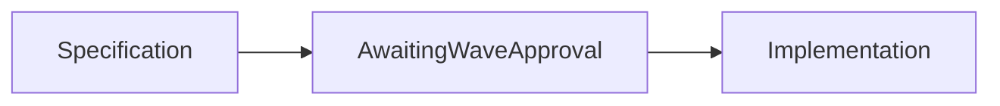

1. Extract fields from synthetic invoices/bank statements; measure accuracy per field and per template, route low confidence to review.

2. Result:
   Acceptance: not measured  
   Performance: not measured  
   Correctness: not measured

3. Architecture:

4. Run it:
No runnable implementation yet. This is a planned Wave 2 project.

5. Decisions and limits: Public repository reserved for independent work using public or synthetic data. Implementation has not started. No company affiliation or usage is claimed. Acceptance check: Per-field accuracy table; review-queue rate vs accuracy tradeoff curve.

6. Next: Implement after approval for Wave 2, then run and publish the required acceptance commands.
